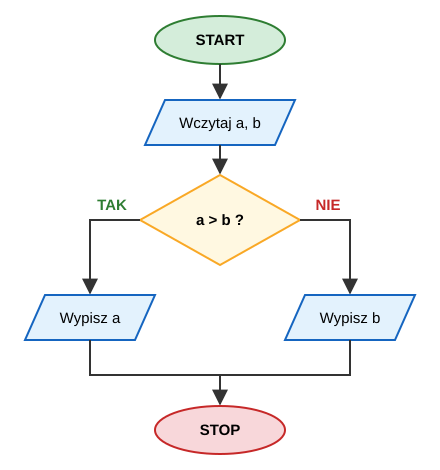

# Programista Python Developer – Dzień 1

**Od instalacji środowiska do podstaw składni języka Python**

| | |
|---|---|
| **Uczelnia** | Uniwersytet WSB Merito we Wrocławiu |
| **Kierunek** | Studia podyplomowe: Programista Python Developer |
| **Opracował** | Bartosz Bryniarski |
| **Wymiar** | 8 godzin dydaktycznych (8 × 45 min) |

---

## Plan dnia

| Nr | Temat | Zakres |
|---|---|---|
| 1 | Instalacja środowiska | Python, PyCharm, pierwsze uruchomienie |
| 2 | Konfiguracja PyCharm | Projekt, interpreter, środowisko wirtualne, uruchamianie i debugowanie |
| 3 | Wprowadzenie do programowania | Algorytm, program, język programowania, kompilacja i interpretacja |
| 4 | Wstęp do języka Python | Historia, filozofia, zastosowania, REPL, `print()`, komentarze, PEP 8 |
| 5 | Zmienne i typy danych | `int`, `float`, `str`, `bool`, `None`, konwersje typów |
| 6 | Operatory i dane wejściowe | Operatory arytmetyczne, porównania, logiczne, `input()` |
| 7 | Napisy (stringi) | Indeksowanie, wycinki, metody, f-stringi |
| 8 | Instrukcje warunkowe | `if` / `elif` / `else`, `match`, ćwiczenia podsumowujące |

---

## 1. Instalacja środowiska

### Cele
- zainstalować interpreter Pythona,
- zainstalować PyCharm,
- sprawdzić, że wszystko działa.

### 1.1. Instalacja Pythona

**Windows**
1. Wejdź na stronę <https://www.python.org/downloads/> i pobierz najnowszą stabilną wersję Pythona 3 (zalecane: 3.12 lub nowsza).
2. Uruchom instalator.
3. **Zaznacz opcję „Add python.exe to PATH”** – to najczęściej pomijany krok!
4. Wybierz „Install Now”.
5. Na końcu kliknij „Disable path length limit” (jeśli się pojawi).

**macOS**
- Pobierz instalator `.pkg` z python.org **lub** użyj Homebrew:
  ```bash
  brew install python
  ```

**Linux (Debian/Ubuntu)**
```bash
sudo apt update
sudo apt install python3 python3-pip python3-venv
```

### 1.2. Weryfikacja instalacji

Otwórz terminal (Windows: `cmd` lub PowerShell) i wpisz:

```bash
python --version
# lub (macOS/Linux)
python3 --version
```

Oczekiwany wynik – np.:
```
Python 3.13.1
```

Sprawdź też menedżer pakietów:
```bash
pip --version
```

> **Typowe problemy**
> - `'python' is not recognized...` → nie zaznaczono „Add to PATH”. Uruchom instalator ponownie → *Modify* → zaznacz dodanie do zmiennych środowiskowych.
> - Na Windows po wpisaniu `python` otwiera się Microsoft Store → wyłącz aliasy: *Ustawienia → Aplikacje → Zaawansowane ustawienia aplikacji → Aliasy wykonywania aplikacji*.

### 1.3. Instalacja PyCharm

1. Wejdź na <https://www.jetbrains.com/pycharm/download/>.
2. Pobierz PyCharm (wersja darmowa wystarcza do całego kursu; studenci mogą bezpłatnie uzyskać licencję na pełną wersję w ramach programu JetBrains for Education).
3. Zainstaluj z domyślnymi opcjami. Na Windows warto zaznaczyć:
   - *Create Desktop Shortcut*,
   - *Add "Open Folder as Project"*,
   - *Add launchers dir to the PATH*.
4. Uruchom PyCharm, zaakceptuj warunki, wybierz motyw (jasny/ciemny).

> **Alternatywy (dla zainteresowanych):** Visual Studio Code z rozszerzeniem Python, Thonny (dla początkujących), Jupyter Notebook (analiza danych).

### Ćwiczenie 1.1
1. Sprawdź wersję Pythona w terminalu.
2. Uruchom interpreter poleceniem `python` (lub `python3`) i wpisz `2 + 2`. Wyjdź poleceniem `exit()`.
3. Uruchom PyCharm i zrób zrzut ekranu ekranu powitalnego.

---

## 2. Konfiguracja PyCharm i pierwszy projekt

### Cele
- utworzyć projekt w PyCharm,
- rozumieć, czym jest interpreter i środowisko wirtualne,
- uruchomić i zdebugować pierwszy program.

### 2.1. Tworzenie projektu

1. *New Project*.
2. Nazwa: `kurs_python`, lokalizacja: dowolny folder.
3. Typ środowiska: **Project venv** (wirtualne środowisko w folderze `.venv`).
4. Wybierz zainstalowany interpreter Pythona.
5. Odznacz lub zostaw „Create a welcome script” (`main.py`).
6. *Create*.

### 2.2. Czym jest środowisko wirtualne (venv)?

**Środowisko wirtualne** to izolowana kopia interpretera z osobnym zestawem bibliotek. Dzięki niemu:
- każdy projekt może mieć inne wersje bibliotek,
- nie „zaśmiecamy” globalnej instalacji Pythona,
- łatwo odtworzyć środowisko na innym komputerze.

Ręczne tworzenie venv (do zapamiętania na przyszłość):
```bash
python -m venv .venv
# aktywacja – Windows
.venv\Scripts\activate
# aktywacja – macOS/Linux
source .venv/bin/activate
```

### 2.3. Budowa okna PyCharm

| Element | Do czego służy |
|---|---|
| **Project** (lewy panel) | drzewo plików projektu |
| **Edytor** (środek) | pisanie kodu |
| **Run** (dół) | wynik działania programu |
| **Terminal** (dół) | wiersz poleceń w katalogu projektu |
| **Python Console** | interaktywny interpreter (REPL) |
| Pasek statusu (prawy dolny róg) | aktualnie używany interpreter |

### 2.4. Pierwszy program

Utwórz plik: prawy klik na projekt → *New → Python File* → `hello.py`.

```python
print("Witaj, świecie!")
print("Uczę się Pythona na WSB Merito we Wrocławiu.")
```

Uruchomienie:
- prawy klik w edytorze → *Run 'hello'*, lub
- skrót **Shift + F10** (Windows/Linux), **Ctrl + R** (macOS),
- zielony trójkąt obok kodu.

Uruchomienie z terminala:
```bash
python hello.py
```

### 2.5. Przydatne skróty klawiszowe (Windows/Linux)

| Skrót | Działanie |
|---|---|
| `Ctrl + /` | zakomentuj / odkomentuj linię |
| `Ctrl + D` | duplikuj linię |
| `Ctrl + Alt + L` | sformatuj kod (zgodnie z PEP 8) |
| `Ctrl + Space` | podpowiedzi |
| `Shift + Shift` | wyszukaj wszystko |
| `Shift + F6` | zmień nazwę (refaktoryzacja) |
| `Alt + Enter` | szybkie poprawki |

*(macOS: zamiast `Ctrl` zwykle `Cmd`.)*

### 2.6. Pierwsze spotkanie z debuggerem

```python
a = 5
b = 7
suma = a + b
print(suma)
```

1. Kliknij na marginesie obok linii `suma = a + b` – pojawi się czerwona kropka (**breakpoint**).
2. Uruchom w trybie debug: **Shift + F9** (lub ikona robaka).
3. Program zatrzyma się na breakpoincie – w panelu *Variables* widać wartości `a` i `b`.
4. **F8** – wykonaj kolejną linię (*Step Over*).

> Debugger to najlepszy przyjaciel programisty – używajmy go od pierwszego dnia.

### Ćwiczenie 2.1
Utwórz plik `wizytowka.py`, który wypisze w trzech liniach: imię i nazwisko, miasto, powód zapisania się na studia.

### Ćwiczenie 2.2
Postaw breakpoint w programie z punktu 2.6, uruchom debugger i prześledź wartości zmiennych krok po kroku.

---

## 3. Wprowadzenie do programowania

### Cele
- zrozumieć pojęcia: algorytm, program, język programowania,
- poznać różnicę między kompilacją a interpretacją,
- zapisać prosty algorytm w pseudokodzie i jako schemat blokowy.

### 3.1. Podstawowe pojęcia

- **Algorytm** – skończony, uporządkowany ciąg jednoznacznych kroków prowadzący do rozwiązania problemu.
- **Program** – algorytm zapisany w języku zrozumiałym dla komputera (języku programowania).
- **Język programowania** – sformalizowany zestaw reguł (składnia + semantyka) do zapisu programów.
- **Kod źródłowy** – tekst programu napisany przez programistę.

**Cechy dobrego algorytmu:**
1. **Poprawność** – daje prawidłowy wynik.
2. **Skończoność** – kończy się po skończonej liczbie kroków.
3. **Jednoznaczność** – każdy krok jest precyzyjnie określony.
4. **Efektywność** – nie marnuje czasu i pamięci.
5. **Ogólność** – rozwiązuje całą klasę problemów, a nie jeden przypadek.

### 3.2. Algorytm z życia codziennego – parzenie herbaty

```
1. Nalej wody do czajnika.
2. Włącz czajnik.
3. Dopóki woda się nie zagotuje – czekaj.
4. Włóż torebkę herbaty do kubka.
5. Zalej herbatę wrzątkiem.
6. Jeśli chcesz słodką herbatę – dodaj cukier.
7. Odczekaj 3 minuty.
8. Wyjmij torebkę.
```

Zauważ, że już tu występują elementy, które poznamy w Pythonie:
- **sekwencja** (kroki po kolei),
- **pętla** („dopóki… czekaj”),
- **warunek** („jeśli… dodaj cukier”).

### 3.3. Sposoby zapisu algorytmów

**a) Opis słowny** – jak wyżej.

**b) Pseudokod** – zapis zbliżony do języka programowania, ale bez ścisłej składni:
```
WCZYTAJ a, b
JEŻELI a > b TO
    WYPISZ a
W PRZECIWNYM RAZIE
    WYPISZ b
```

**c) Schemat blokowy** – zapis graficzny:



Symbole: owal – start/stop, równoległobok – wejście/wyjście, prostokąt – operacja, romb – decyzja.

**d) Kod w Pythonie** – ten sam algorytm:
```python
a = int(input("Podaj a: "))
b = int(input("Podaj b: "))
if a > b:
    print(a)
else:
    print(b)
```

### 3.4. Jak komputer wykonuje program?

Procesor rozumie wyłącznie **kod maszynowy** (ciągi zer i jedynek). Języki programowania wysokiego poziomu trzeba przetłumaczyć:

| | **Kompilacja** | **Interpretacja** |
|---|---|---|
| Jak działa | cały program tłumaczony z góry do pliku wykonywalnego | program tłumaczony i wykonywany na bieżąco |
| Przykłady | C, C++, Rust, Go | Python, JavaScript, Ruby |
| Zalety | szybkość działania | szybki cykl „napisz–uruchom”, przenośność |
| Wady | trzeba kompilować po każdej zmianie | zwykle wolniejsze działanie |

> **Python w praktyce:** CPython najpierw kompiluje kod do **bajtkodu** (pliki `.pyc` w folderze `__pycache__`), a następnie wykonuje go na **maszynie wirtualnej Pythona**. Z perspektywy programisty Python zachowuje się jak język interpretowany.

### 3.5. Paradygmaty programowania (zarys)

- **Proceduralny** – program jako ciąg instrukcji i procedur (funkcji) – *dzień 2*.
- **Obiektowy** – program jako zbiór współpracujących obiektów – *kolejne zajęcia*.
- **Funkcyjny** – program jako złożenie funkcji bez efektów ubocznych.

Python jest językiem **wieloparadygmatowym** – wspiera wszystkie trzy.

### 3.6. Błędy w programach

- **Błędy składniowe** (*syntax errors*) – naruszenie reguł języka; program się nie uruchomi.
- **Błędy wykonania** (*runtime errors*) – np. dzielenie przez zero; program przerywa działanie.
- **Błędy logiczne** – program działa, ale daje zły wynik. Najtrudniejsze do znalezienia!

### Ćwiczenie 3.1
Zapisz słownie algorytm wypłaty gotówki z bankomatu. Zaznacz, które kroki są warunkami, a które pętlami.

### Ćwiczenie 3.2
Zapisz w pseudokodzie algorytm, który wczytuje trzy liczby i wypisuje największą z nich.

### Ćwiczenie 3.3
Narysuj schemat blokowy algorytmu: „Wczytaj wiek. Jeśli wiek ≥ 18, wypisz «Pełnoletni», w przeciwnym razie wypisz «Niepełnoletni»”.

---

## 4. Wstęp do języka Python

### Cele
- poznać historię i filozofię Pythona,
- korzystać z interaktywnej konsoli,
- używać `print()` i komentarzy,
- znać podstawy stylu PEP 8.

### 4.1. Krótka historia

- Twórca: **Guido van Rossum** (Holandia).
- Prace rozpoczęte pod koniec lat 80., pierwsza publiczna wersja: **1991**.
- Nazwa pochodzi od grupy komediowej **Monty Python**, a nie od węża.
- **Python 2** (2000) – oficjalnie zakończony w 2020 r.
- **Python 3** (2008) – obecnie jedyna rozwijana linia. Nowa wersja pojawia się co roku w październiku.

### 4.2. Dlaczego Python?

- czytelna, zwięzła składnia (wcięcia zamiast nawiasów klamrowych),
- ogromna biblioteka standardowa („baterie w zestawie”),
- setki tysięcy zewnętrznych pakietów (PyPI),
- jeden z najpopularniejszych języków na świecie (czołówka rankingów TIOBE, IEEE, Stack Overflow),
- darmowy i otwartoźródłowy.

**Zastosowania:** aplikacje webowe (Django, Flask, FastAPI), analiza danych (pandas, NumPy), uczenie maszynowe i AI (scikit-learn, PyTorch), automatyzacja i skrypty, testowanie, DevOps, nauka i edukacja.

### 4.3. Zen Pythona

W konsoli Pythona wpisz:
```python
import this
```

Wybrane zasady (w tłumaczeniu):
- Piękne jest lepsze niż brzydkie.
- Jawne jest lepsze niż niejawne.
- Proste jest lepsze niż złożone.
- Czytelność się liczy.
- Powinien istnieć jeden – najlepiej tylko jeden – oczywisty sposób zrobienia czegoś.

### 4.4. Interaktywna konsola (REPL)

**REPL** = *Read – Eval – Print – Loop*. Idealna do szybkich eksperymentów.

```python
>>> 2 + 3
5
>>> 10 / 3
3.3333333333333335
>>> "Python" * 3
'PythonPythonPython'
>>> help(print)
```

W PyCharm: zakładka **Python Console** na dole okna.

### 4.5. Funkcja `print()`

```python
print("Ala ma kota")
print("Ala", "ma", "kota")             # argumenty oddzielone spacją
print("Ala", "ma", "kota", sep="-")    # własny separator: Ala-ma-kota
print("Bez nowej linii", end=" ")      # na końcu spacja zamiast \n
print("– ciąg dalszy")
print("Kla", end="")                   # end="" – nic na końcu
print("wiatura")                       # Klawiatura
print("Ładowanie", end="...")          # Ładowanie...gotowe
print("gotowe")
print()                                # pusta linia
print("Linia 1\nLinia 2")              # \n – znak nowej linii
print("Kolumna1\tKolumna2")            # \t – tabulator
```

### 4.6. Komentarze

```python
# To jest komentarz jednoliniowy – interpreter go ignoruje

print("Hello")  # komentarz na końcu linii

"""
To jest wieloliniowy napis (docstring).
Często używany jako dokumentacja na początku pliku lub funkcji.
"""
```

> Dobry komentarz wyjaśnia **dlaczego**, a nie **co** robi kod.

### 4.7. Wcięcia – serce składni Pythona

Python używa **wcięć** (zalecane: 4 spacje) do grupowania instrukcji w bloki:

```python
if 5 > 3:
    print("Pięć jest większe od trzech")   # wewnątrz bloku
    print("To też jest w bloku")
print("A to już poza blokiem")
```

Błędne wcięcie:
```python
if 5 > 3:
print("Błąd!")   # IndentationError: expected an indented block
```

### 4.8. PEP 8 – styl kodu (najważniejsze zasady)

- wcięcia: **4 spacje**,
- długość linii: do **79** znaków (w praktyce często 88–120),
- nazwy zmiennych i funkcji: `snake_case` → `liczba_studentow`,
- nazwy stałych: `UPPER_CASE` → `MAX_PROBY = 3`,
- spacje wokół operatorów: `x = a + b`, a nie `x=a+b`,
- dwie puste linie między definicjami funkcji najwyższego poziomu.

W PyCharm: **Ctrl + Alt + L** automatycznie formatuje kod.

### Ćwiczenie 4.1
W konsoli Pythona oblicz: `7 * 8`, `2 ** 10`, `17 / 4`, `17 // 4`, `17 % 4`. Co oznaczają ostatnie trzy operacje? (Wrócimy do tego w rozdziale 6 „Operatory i dane wejściowe”).

### Ćwiczenie 4.2
Używając **jednego** wywołania `print()` i znaków `\n` oraz `\t`, wypisz:
```
Imię:	Jan
Miasto:	Wrocław
Kurs:	Python
```

### Ćwiczenie 4.3
Wypisz datę `09.10.2026` za pomocą `print(9, 10, 2026, sep=...)`.

---

## 5. Zmienne i typy danych

### Cele
- tworzyć zmienne i nadawać im wartości,
- znać podstawowe typy danych,
- konwertować typy.

### 5.1. Zmienne

**Zmienna** to nazwa (etykieta) wskazująca na obiekt w pamięci.

```python
imie = "Anna"
wiek = 28
wzrost = 1.68
student = True

print(imie, wiek, wzrost, student)
```

**Zasady nazewnictwa:**
- może zawierać litery, cyfry i `_`,
- nie może zaczynać się od cyfry (`1x` ✗, `x1` ✓),
- wielkość liter ma znaczenie (`wiek` ≠ `Wiek`),
- nie może być słowem kluczowym (`if`, `for`, `class`, `def`, `True`…).

```python
import keyword
print(keyword.kwlist)   # lista słów kluczowych
```

**Przypisania wielokrotne:**
```python
x = y = z = 0          # ta sama wartość
a, b, c = 1, 2, 3      # rozpakowanie
a, b = b, a            # zamiana wartości – idiom Pythona!
```

### 5.2. Typowanie dynamiczne

W Pythonie nie deklarujemy typu – jest on ustalany w trakcie działania programu i może się zmieniać:

```python
x = 10
print(type(x))   # <class 'int'>
x = "dziesięć"
print(type(x))   # <class 'str'>
```

> Choć to możliwe, zmiana typu zmiennej w trakcie programu zwykle **utrudnia czytanie kodu**.

### 5.3. Podstawowe typy danych

| Typ | Opis | Przykład |
|---|---|---|
| `int` | liczba całkowita (dowolnie duża) | `42`, `-7`, `1_000_000` |
| `float` | liczba zmiennoprzecinkowa | `3.14`, `-0.5`, `2e3` |
| `str` | napis (tekst) | `"Python"`, `'abc'` |
| `bool` | wartość logiczna | `True`, `False` |
| `NoneType` | brak wartości | `None` |
| `complex` | liczba zespolona | `3 + 4j` |

```python
duza = 2 ** 100
print(duza)               # Python nie ma limitu wielkości int!

print(0.1 + 0.2)          # 0.30000000000000004 – uwaga na float!
print(round(0.1 + 0.2, 2))  # 0.3

wynik = None
print(wynik is None)      # True
```

> **Dlaczego `0.1 + 0.2 != 0.3`?** Liczby zmiennoprzecinkowe są przechowywane binarnie i nie da się dokładnie zapisać 0.1. Do obliczeń finansowych używa się modułu `decimal`.
>
> 📖 Więcej: [Zrozumienie niedokładności liczb zmiennoprzecinkowych](https://brylka.net/zrozumienie-niedokladnosci-liczb-zmiennoprzecinkowych)

### 5.4. Konwersja typów

```python
int("42")        # 42
int(3.99)        # 3  (obcięcie, nie zaokrąglenie!)
float("3.14")    # 3.14
float(5)         # 5.0
str(100)         # '100'
bool(0)          # False
bool("")         # False
bool("tekst")    # True
bool(None)       # False

int("abc")       # ValueError: invalid literal for int()
```

**Łączenie tekstu z liczbą – częsty błąd początkujących:**

```python
a = "Rok: "
b = 2026

print(a + b)            # TypeError: can only concatenate str (not "int") to str
print(a + str(b))       # Rok: 2026   – jawna konwersja liczby na tekst
print(a, b)             # Rok:  2026  – print wstawia spację między argumentami (tu podwójna!)
print(a, b, sep="")     # Rok: 2026   – separator pusty
print(f"{a}{b}")        # Rok: 2026   – f-string (szczegóły w rozdziale 7)
```

> Operator `+` nie zgaduje, czy chodzi o dodawanie liczb, czy sklejanie tekstu – dlatego `"Rok: " + 2026` to błąd. Typ trzeba ujednolicić samemu.

**Wartości „fałszywe” (falsy):** `0`, `0.0`, `""`, `None`, `False`, puste kolekcje (`[]`, `{}`, `()`). Wszystko inne jest „prawdziwe” (truthy).

### 5.5. Funkcje `type()` i `isinstance()`

```python
x = 3.5
print(type(x))               # <class 'float'>
print(isinstance(x, float))  # True
print(isinstance(x, (int, float)))  # True – sprawdzenie kilku typów
```

### Ćwiczenie 5.1
Utwórz zmienne opisujące samochód: marka, model, rok produkcji, przebieg (km), pojemność silnika (l), czy_elektryczny. Wypisz każdą zmienną razem z jej typem.

### Ćwiczenie 5.2
Bez uruchamiania kodu przewidź wynik, a potem sprawdź:
```python
print(int("7") + int("3"))
print("7" + "3")
print(int(9.99))
print(bool("False"))
print(float("1e2"))
```

### Ćwiczenie 5.3
Masz zmienne `a = 5` i `b = 9`. Zamień ich wartości na dwa sposoby: z użyciem zmiennej pomocniczej oraz w stylu Pythona (jedna linia).

---

## 6. Operatory i dane wejściowe

### Cele
- używać operatorów arytmetycznych, porównania i logicznych,
- znać priorytet operatorów,
- pobierać dane od użytkownika.

### 6.1. Operatory arytmetyczne

| Operator | Działanie | Przykład | Wynik |
|---|---|---|---|
| `+` | dodawanie | `7 + 2` | `9` |
| `-` | odejmowanie | `7 - 2` | `5` |
| `*` | mnożenie | `7 * 2` | `14` |
| `/` | dzielenie (zawsze `float`) | `7 / 2` | `3.5` |
| `//` | dzielenie całkowite | `7 // 2` | `3` |
| `%` | reszta z dzielenia (modulo) | `7 % 2` | `1` |
| `**` | potęgowanie | `7 ** 2` | `49` |

```python
# Przydatne zastosowania % i //
liczba = 17
print(liczba % 2 == 0)   # czy parzysta? False

sekundy = 3725
godziny = sekundy // 3600
minuty = (sekundy % 3600) // 60
sek = sekundy % 60
print(godziny, minuty, sek)   # 1 2 5

print(divmod(17, 5))     # (3, 2) – iloraz i reszta naraz
```

### 6.2. Operatory przypisania złożonego

```python
x = 10
x += 5    # x = x + 5   → 15
x -= 3    # x = x - 3   → 12
x *= 2    # x = x * 2   → 24
x /= 4    # x = x / 4   → 6.0
x //= 4   # → 1.0
x **= 3   # → 1.0
```

> W Pythonie **nie ma** `x++` ani `x--`.

### 6.3. Operatory porównania

Zwracają `True` lub `False`:

```python
print(5 == 5)    # równe
print(5 != 3)    # różne
print(5 > 3, 5 < 3, 5 >= 5, 5 <= 4)

# Łańcuchowanie porównań – cecha Pythona
wiek = 25
print(18 <= wiek < 65)   # True
```

### 6.4. Operatory logiczne

| Operator | Znaczenie |
|---|---|
| `and` | oba warunki prawdziwe |
| `or` | co najmniej jeden prawdziwy |
| `not` | zaprzeczenie |

```python
ma_bilet = True
ma_dowod = False
print(ma_bilet and ma_dowod)   # False
print(ma_bilet or ma_dowod)    # True
print(not ma_dowod)            # True
```

**Tabela prawdy:**

| A | B | A and B | A or B |
|---|---|---|---|
| True | True | True | True |
| True | False | False | True |
| False | True | False | True |
| False | False | False | False |

### 6.5. Operatory przynależności i tożsamości

```python
print("a" in "Python")      # False
print("th" in "Python")     # True
print("x" not in "abc")     # True

x = None
print(x is None)            # True – do None zawsze używamy `is`
```

### 6.6. Priorytet operatorów (od najwyższego)

1. `()` – nawiasy
2. `**`
3. `-x` (minus jednoargumentowy)
4. `*`, `/`, `//`, `%`
5. `+`, `-`
6. `==`, `!=`, `<`, `>`, `<=`, `>=`, `in`, `is`
7. `not`
8. `and`
9. `or`

```python
print(2 + 3 * 4)      # 14
print((2 + 3) * 4)    # 20
print(-2 ** 2)        # -4 (!)  – potęga ma wyższy priorytet niż minus
print((-2) ** 2)      # 4
```

> **Zasada praktyczna:** gdy masz wątpliwości – dodaj nawiasy.

### 6.7. Pobieranie danych – `input()`

`input()` **zawsze zwraca napis** (`str`)!

```python
imie = input("Jak masz na imię? ")
print("Cześć,", imie)

wiek = input("Ile masz lat? ")
print(type(wiek))         # <class 'str'>
# print(wiek + 1)         # TypeError!
wiek = int(wiek)
print("Za rok będziesz mieć", wiek + 1, "lat")

# Krócej:
wzrost = float(input("Podaj wzrost w metrach: "))
```

### Przykład – kalkulator BMI

```python
waga = float(input("Podaj wagę (kg): "))
wzrost = float(input("Podaj wzrost (m): "))
bmi = waga / wzrost ** 2
print("Twoje BMI:", round(bmi, 2))
```

### Ćwiczenie 6.1
Napisz program, który wczytuje dwie liczby całkowite i wypisuje wynik wszystkich siedmiu operacji arytmetycznych.

### Ćwiczenie 6.2
Napisz przelicznik temperatury: wczytaj stopnie Celsjusza i wypisz wartość w stopniach Fahrenheita (`F = C * 9/5 + 32`) oraz Kelvina (`K = C + 273.15`).

### Ćwiczenie 6.3
Wczytaj liczbę minut i wypisz ją w formacie: „X dni, Y godzin, Z minut” (użyj `//` i `%`).

### Ćwiczenie 6.4
Bez uruchamiania przewidź wynik:
```python
print(10 - 2 * 3 ** 2)
print(not True or True and False)
print(15 % 4 + 15 // 4)
print(3 < 5 < 4)
```

---

## 7. Napisy (stringi)

### Cele
- indeksować i wycinać fragmenty napisów,
- używać najważniejszych metod napisów,
- formatować tekst za pomocą f-stringów.

### 7.1. Tworzenie napisów

```python
a = 'pojedyncze cudzysłowy'
b = "podwójne cudzysłowy"
c = "Napis z 'apostrofem' w środku"
d = """Napis
wieloliniowy"""
e = r"C:\nowy\folder"   # raw string – \n nie jest znakiem nowej linii
```

### 7.2. Indeksowanie

```
 P   y   t   h   o   n
 0   1   2   3   4   5     ← indeksy dodatnie
-6  -5  -4  -3  -2  -1     ← indeksy ujemne
```

```python
s = "Python"
print(s[0])     # P
print(s[5])     # n
print(s[-1])    # n  – ostatni znak
print(len(s))   # 6
# print(s[10])  # IndexError
```

**Napisy są niemutowalne** (nie można ich zmieniać):
```python
s[0] = "J"      # TypeError
s = "J" + s[1:] # tworzymy nowy napis: "Jython"
```

### 7.3. Wycinki (slicing) – `s[start:stop:krok]`

```python
s = "Programowanie"
print(s[0:7])     # Program  (stop nie wchodzi!)
print(s[:7])      # Program
print(s[7:])      # owanie
print(s[-6:])     # owanie
print(s[::2])     # Porm...  co drugi znak
print(s[::-1])    # einawomargorP – odwrócenie napisu
```

### 7.4. Operacje na napisach

```python
print("Ala" + " " + "ma kota")   # konkatenacja
print("-" * 20)                   # powtórzenie
print("kot" in "Ala ma kota")     # True
```

### 7.5. Najważniejsze metody

```python
s = "  Uniwersytet WSB Merito  "

s.upper()              # '  UNIWERSYTET WSB MERITO  '
s.lower()              # '  uniwersytet wsb merito  '
s.strip()              # 'Uniwersytet WSB Merito'
s.strip().title()      # 'Uniwersytet Wsb Merito'
s.replace("WSB", "X")  # zamiana fragmentu
s.count("i")           # liczba wystąpień
s.find("WSB")          # indeks pierwszego wystąpienia (-1 jeśli brak)
s.strip().startswith("Uni")  # True
s.strip().endswith("to")     # True

"a,b,c".split(",")           # ['a', 'b', 'c']
"Ala ma kota".split()        # ['Ala', 'ma', 'kota']
"-".join(["2026", "10", "09"])  # '2026-10-09'

"123".isdigit()        # True
"abc".isalpha()        # True
"Abc".islower()        # False
```

> Metody **nie modyfikują** oryginału – zwracają nowy napis. Wynik trzeba przypisać: `s = s.strip()`.

### 7.6. Formatowanie – f-stringi

```python
imie = "Bartosz"
wiek = 30
cena = 49.9

print(f"Nazywam się {imie} i mam {wiek} lat.")
print(f"Za 5 lat będę mieć {wiek + 5} lat.")
print(f"Cena: {cena:.2f} zł")         # 2 miejsca po przecinku → 49.90
print(f"{'lewo':<10}|")               # wyrównanie do lewej
print(f"{'prawo':>10}|")              # do prawej
print(f"{'środek':^10}|")             # do środka
print(f"{1234567:,}")                  # 1,234,567
print(f"{0.256:.1%}")                  # 25.6%
print(f"{imie=}")                      # imie='Bartosz' – przydatne przy debugowaniu
```

Starsze sposoby (warto rozpoznawać w cudzym kodzie):
```python
print("Mam {} lat".format(wiek))
print("Mam %d lat" % wiek)
```

### Ćwiczenie 7.1
Wczytaj imię i nazwisko (jako jeden napis, np. `jan kowalski`). Wypisz:
- je z wielkich liter (`Jan Kowalski`),
- inicjały (`J.K.`),
- liczbę liter (bez spacji).

### Ćwiczenie 7.2
Dla napisu `s = "Wrocław jest piękny"` wypisz: pierwsze 7 znaków, ostatnie 6 znaków, napis odwrócony, co trzeci znak.

### Ćwiczenie 7.3
Wczytaj słowo i sprawdź (wypisz `True`/`False`), czy jest palindromem (np. „kajak”). Wielkość liter nie powinna mieć znaczenia.

### Ćwiczenie 7.4
Wypisz „paragon” za pomocą f-stringów, z wyrównaniem kolumn:
```
Produkt         Ilość      Cena
Chleb               2      8.50
Mleko               3     11.97
-------------------------------
RAZEM                     20.47
```

---

## 8. Instrukcje warunkowe

### Cele
- podejmować decyzje w programie (`if`, `elif`, `else`),
- łączyć warunki,
- poznać wyrażenie warunkowe i instrukcję `match`.

### 8.1. Instrukcja `if`

```python
temperatura = 25

if temperatura > 20:
    print("Jest ciepło")
    print("Weź okulary przeciwsłoneczne")
```

### 8.2. `if` – `else`

```python
liczba = int(input("Podaj liczbę: "))

if liczba % 2 == 0:
    print("Parzysta")
else:
    print("Nieparzysta")
```

### 8.3. `if` – `elif` – `else`

```python
punkty = int(input("Liczba punktów (0-100): "))

if punkty >= 90:
    ocena = 5.0
elif punkty >= 80:
    ocena = 4.5
elif punkty >= 70:
    ocena = 4.0
elif punkty >= 60:
    ocena = 3.5
elif punkty >= 50:
    ocena = 3.0
else:
    ocena = 2.0

print(f"Ocena: {ocena}")
```

> Warunki sprawdzane są **od góry** – wykonuje się tylko pierwszy spełniony blok.

### 8.4. Warunki złożone i zagnieżdżone

```python
wiek = int(input("Wiek: "))
ma_prawo_jazdy = input("Masz prawo jazdy? (t/n): ") == "t"

if wiek >= 18 and ma_prawo_jazdy:
    print("Możesz wypożyczyć samochód")
elif wiek >= 18:
    print("Najpierw zrób prawo jazdy")
else:
    print("Jesteś za młody")
```

Zagnieżdżanie (używać z umiarem):
```python
if wiek >= 18:
    if ma_prawo_jazdy:
        print("Możesz prowadzić")
    else:
        print("Brak prawa jazdy")
```

### 8.5. Wykorzystanie wartości truthy/falsy

```python
imie = input("Imię: ")
if imie:                      # zamiast: if imie != ""
    print(f"Witaj, {imie}!")
else:
    print("Nie podano imienia")
```

### 8.6. Wyrażenie warunkowe (operator trójargumentowy)

```python
wiek = 20
status = "pełnoletni" if wiek >= 18 else "niepełnoletni"
print(status)
```

### 8.7. Instrukcja `match` (Python 3.10+)

```python
dzien = input("Podaj numer dnia tygodnia (1-7): ")

match dzien:
    case "1" | "2" | "3" | "4" | "5":
        print("Dzień roboczy")
    case "6" | "7":
        print("Weekend!")
    case _:
        print("Niepoprawny numer")
```

### Przykład podsumowujący – prosty kalkulator

```python
a = float(input("Pierwsza liczba: "))
operator = input("Operator (+, -, *, /): ")
b = float(input("Druga liczba: "))

if operator == "+":
    wynik = a + b
elif operator == "-":
    wynik = a - b
elif operator == "*":
    wynik = a * b
elif operator == "/":
    if b == 0:
        wynik = None
        print("Nie można dzielić przez zero!")
    else:
        wynik = a / b
else:
    wynik = None
    print("Nieznany operator")

if wynik is not None:
    print(f"{a} {operator} {b} = {wynik}")
```

### Ćwiczenie 8.1
Wczytaj liczbę i wypisz, czy jest dodatnia, ujemna, czy równa zero.

### Ćwiczenie 8.2
Wczytaj rok i sprawdź, czy jest przestępny. Rok jest przestępny, gdy jest podzielny przez 4 i niepodzielny przez 100, **albo** podzielny przez 400.

### Ćwiczenie 8.3
Rozbuduj kalkulator BMI z rozdziału 6 o interpretację wyniku:
- < 18,5 – niedowaga,
- 18,5–24,9 – waga prawidłowa,
- 25–29,9 – nadwaga,
- ≥ 30 – otyłość.

### Ćwiczenie 8.4
Wczytaj trzy liczby (długości boków) i sprawdź, czy można zbudować z nich trójkąt (suma dwóch dowolnych boków musi być większa od trzeciego). Jeśli tak – określ, czy jest równoboczny, równoramienny czy różnoboczny.

### Ćwiczenie 8.5
Kino: bilet normalny kosztuje 30 zł. Dzieci do 12 lat płacą 50%, seniorzy od 65 lat – 60%, studenci (pytamy t/n) – 75% ceny. Zniżki się nie sumują – obowiązuje najkorzystniejsza. Wczytaj dane i wypisz cenę biletu.

### Ćwiczenie 8.6 (dla chętnych)
Przepisz ćwiczenie 8.1 lub kalkulator z wykorzystaniem instrukcji `match`.

---

## Podsumowanie dnia 1

Po dzisiejszych zajęciach potrafisz:
- ✅ zainstalować i skonfigurować Pythona oraz PyCharm,
- ✅ tworzyć projekt ze środowiskiem wirtualnym, uruchamiać i debugować kod,
- ✅ wyjaśnić pojęcia: algorytm, program, kompilacja, interpretacja,
- ✅ korzystać ze zmiennych i podstawowych typów danych,
- ✅ stosować operatory i pobierać dane od użytkownika,
- ✅ przetwarzać napisy i formatować tekst,
- ✅ sterować przebiegiem programu za pomocą instrukcji warunkowych.

### Zadanie domowe

1. **Kantor:** program pyta o kwotę w PLN i walutę docelową (EUR, USD, GBP), a następnie przelicza kwotę według kursów zapisanych w zmiennych. Wynik formatowany do 2 miejsc po przecinku. Obsłuż nieznaną walutę.
2. **Walidator hasła:** program wczytuje hasło i sprawdza, czy ma co najmniej 8 znaków, nie składa się z samych cyfr ani z samych liter. Wypisuje stosowny komunikat.
3. **Znak zodiaku (dla chętnych):** na podstawie dnia i miesiąca urodzenia wypisz znak zodiaku.

---

## Rozwiązania wybranych ćwiczeń

<details>
<summary>Ćwiczenie 4.2</summary>

```python
print("Imię:\tJan\nMiasto:\tWrocław\nKurs:\tPython")
```
</details>

<details>
<summary>Ćwiczenie 4.3</summary>

```python
print("09", 10, 2026, sep=".")
# lub: print(f"{9:02d}.{10}.{2026}")
```
</details>

<details>
<summary>Ćwiczenie 5.2</summary>

```
10
73
9
True     ← niepusty napis jest zawsze truthy
100.0
```
</details>

<details>
<summary>Ćwiczenie 5.3</summary>

```python
a, b = 5, 9
# sposób 1
tmp = a
a = b
b = tmp
# sposób 2 (pythonowy)
a, b = b, a
```
</details>

<details>
<summary>Ćwiczenie 6.3</summary>

```python
minuty = int(input("Podaj liczbę minut: "))
dni = minuty // (24 * 60)
godziny = (minuty % (24 * 60)) // 60
reszta = minuty % 60
print(f"{dni} dni, {godziny} godzin, {reszta} minut")
```
</details>

<details>
<summary>Ćwiczenie 6.4</summary>

```
-8      ← 3**2=9, 2*9=18, 10-18
False   ← (not True) or (True and False) → False or False
6       ← 3 + 3
False   ← 3<5 and 5<4
```
</details>

<details>
<summary>Ćwiczenie 7.1</summary>

```python
dane = input("Imię i nazwisko: ").strip()
print(dane.title())
imie, nazwisko = dane.split()
print(f"{imie[0].upper()}.{nazwisko[0].upper()}.")
print(len(dane.replace(" ", "")))
```
</details>

<details>
<summary>Ćwiczenie 7.3</summary>

```python
slowo = input("Podaj słowo: ").lower()
print(slowo == slowo[::-1])
```
</details>

<details>
<summary>Ćwiczenie 7.4</summary>

```python
print(f"{'Produkt':<15}{'Ilość':>6}{'Cena':>10}")
print(f"{'Chleb':<15}{2:>6}{8.50:>10.2f}")
print(f"{'Mleko':<15}{3:>6}{11.97:>10.2f}")
print("-" * 31)
print(f"{'RAZEM':<21}{8.50 + 11.97:>10.2f}")
```
</details>

<details>
<summary>Ćwiczenie 8.2</summary>

```python
rok = int(input("Podaj rok: "))
if (rok % 4 == 0 and rok % 100 != 0) or rok % 400 == 0:
    print("Przestępny")
else:
    print("Nieprzestępny")
```
</details>

<details>
<summary>Ćwiczenie 8.4</summary>

```python
a = float(input("a: "))
b = float(input("b: "))
c = float(input("c: "))

if a + b > c and a + c > b and b + c > a:
    if a == b == c:
        print("Trójkąt równoboczny")
    elif a == b or b == c or a == c:
        print("Trójkąt równoramienny")
    else:
        print("Trójkąt różnoboczny")
else:
    print("Z tych odcinków nie zbudujesz trójkąta")
```
</details>

<details>
<summary>Ćwiczenie 8.5</summary>

```python
CENA = 30
wiek = int(input("Wiek: "))
student = input("Student? (t/n): ").lower() == "t"

mnoznik = 1.0
if wiek <= 12:
    mnoznik = 0.5
elif wiek >= 65:
    mnoznik = 0.6
elif student:
    mnoznik = 0.75
# kolejność gałęzi zapewnia najkorzystniejszą zniżkę
# (dziecko 50% < senior 60% < student 75%)

print(f"Cena biletu: {CENA * mnoznik:.2f} zł")
```
</details>